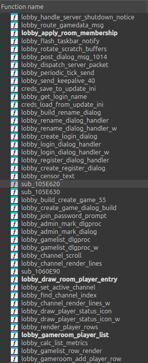
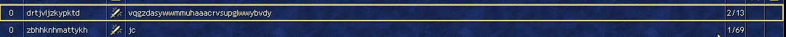
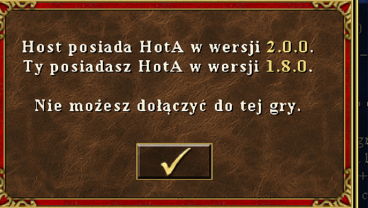

I've played Heroes of Might and Magic 3 with the [HD](https://sites.google.com/site/heroes3hd/) and [HOTA](https://h3hota.com/en/download) mods for years and always wondered how
its online lobby actually works - how accounts, rooms, and chat go over the wire. So I loaded
`HD_HOTA.dll` (the DLL implementing the whole lobby client) into [IDA](https://hex-rays.com/ida-pro) and dug in. A good chunk of
the analysis was done with the help of AI. This post is a short, security-focused summary of what came out of it.
Everything - the write-ups and byte-exact packet layouts, the annotated IDA database, and a
from-scratch Python client library - is on GitHub:
[github.com/rivit98/h3-tools](https://github.com/rivit98/h3-tools).

> **Update:** this analysis reflects the state of the lobby as of **2026-09-03**. Since then at
> least one of the issues has been fixed - the crash-report server crash (cmd 94) no longer
> works. Other findings may have been addressed too.

## TL;DR

Nearly everything the lobby trusts is client-authored and taken on faith - identity, room
metadata, name-length limits, even the right to rename an account - so most of these findings are
just a matter of sending the packet the UI won't. Two are potential server-side crashes; one of
those ships with a working proof-of-concept. All testing was **client→server only**, against the
live server with throwaway accounts - no MITM, no server-side access.

| # | Finding | Impact | Status |
|---|---------|--------|--------|
| 1 | Client-supplied fingerprint | Forge it per connection → the anti-multi-account cap never applies (squatting, ban evasion, unlimited registration) | Confirmed |
| 2 | Oversized / forged rooms | Unclamped capacity byte and version field → rooms advertising 13+ (or negative) slots and fake HotA builds | Confirmed |
| 3 | One- and two-letter accounts | Three-char minimum is client-side only → claim the short-name space | Confirmed |
| 4 | Unsolicited rename | Rename packet (cmd 137) accepted any time, no server-forced prompt required | Confirmed |
| 5 | Relay-packet crash (cmd 62) | Theoretical: `frame_len - 16` underflow → oversized allocation / server crash | Unconfirmed |
| 6 | Crash-report server crash (cmd 94) | Live DoS: forged `count` → one tiny packet triggers huge allocation/loop | Confirmed (PoC), fixed since |
| 7 | Save-game "passwords" | Password gates nothing - the save is unencrypted behind it | Confirmed |
| 8 | Credentials on disk | "Remember password" stores login behind reversible XOR, no key/salt | Confirmed |

## Where this started

This didn't begin as a security project at all. Back in June 2024 I just wanted *data*: the lobby
will tell you, on request, its entire player list and every game a given player has ever finished -
rating before and after, towns, starting heroes, map template, game result - so I started reverse-engineering
just enough of the protocol to pull all of that into a database and do some ranking and analysis of
my own.

The shape of it: two dumpers built on the reversed request/response packets. One walks the whole
player-ID space in the 20-entries-per-query batches the server will actually answer, enumerating
every account; the other pages each player's match history backwards by timestamp until it runs
dry. A pool of throwaway lobby accounts drives the queries so no single account gets hammered, and
the parsed rows land in Postgres behind a FastAPI
service. I ended up with a complete player list (nick, id) and match history for every player - a lot of data.

But reverse-engineering each packet and keeping the whole pipeline working was slow, time-consuming
work, so after June 2024 I set the project aside for a long time - and never actually finished it.
By the time I came back to it, [hotameta.com](https://hotameta.com/) already existed and does all of
this - and a great deal more - properly, so I shelved it for good. The code is very much unfinished
and, frankly, in rough shape: no login/registration flow, a half-written webserver, imports still
broken from a mid-project reorganization, and TODOs scattered throughout - though it does have a nice network layer. It's in the repo as-is, warts and all.
Find it [here](https://github.com/rivit98/h3-tools/tree/master/lobby-game-history).

Picking the protocol back up much later - this time to understand how the lobby really worked rather
than to scrape it - is what turned into the security dig that makes up the rest of this post.

## Methodology

`HD_HOTA.dll` is a plain x86 DLL - no packing or obfuscation - so static analysis with Hex-Rays
was straightforward. It talks to a hardcoded production server (`5.252.35.46:6846`) over a single **plaintext TCP** socket, no TLS. The address isn't stored as a string;
it's rebuilt character-by-character at runtime, which only defeats IDA's string search, not the
analysis itself.

The HD mod itself never touches `Heroes3.exe` on disk. It ships as a DLL that's loaded into the running
game and rewrites it *in memory* at runtime - installing hooks and byte-patches over the original
code through baratorch's `patcher_x86`, the same runtime-patching engine the whole Heroes 3/4 modding scene is built on
([patcher_x86.hpp](https://github.com/RoseKavalier/H4MS/blob/master/H4API/lib/patcher_x86.hpp)) - which
is why the entire lobby client lives in this DLL rather than in the game executable.

The approach was mechanical: decompile every packet builder and the big dispatcher (`lobby_dispatch_server_packet`) and read the byte offsets
straight off. To prove the recovered layouts were right rather than plausible, I wrote a small
Python client (`h3lobby`) from scratch against the reversed formats and replayed it at the live
server - register a throwaway account, log in, watch the lobby stream back. It worked end to
end, which confirmed the formats.



*A slice of the IDA function list after annotation - the `lobby_*` builders, handlers and
dispatcher that the whole write-up was read off.*

<br>

## The protocol

Every packet, both directions, uses the same 4-byte header:

<pre style="white-space:pre; overflow-x:auto">
0        2       4           len
+--------+-------+-------------+
| length |  cmd  | payload ... |
| (u16)  | (u16) |             |
+--------+-------+-------------+</pre>

`length` is the *total* frame size including the header; `cmd` selects the handler. Frames
larger than 4096 or smaller than 4 bytes are treated as corruption and the connection drops.
Credential fields (username / password / email) are pushed through a running-key XOR
obfuscator before hitting the wire - not encryption, just enough to hide a password from
Wireshark's "follow TCP stream" at a glance. Everything else is sent in the clear.

Auth packets also carry a client-version stamp that the server checks. When the HD mod ships a new build
the server raises the minimum version it will accept, and an out-of-date client is rejected with a
result code ≥ 5,000,000 - the number itself is the required version (the stock client formats it
into a "please update to version %s" message).

## Findings

#### Client-supplied fingerprint

The hardware fingerprint is entirely client-supplied. Registration and login both carry a
"fingerprint" (scrambled disk serial + MAC) meant to identify your machine and back the
anti-multi-account limit. But it's just a field in the packet - the server has no way to check
it's real. Rotate a random fingerprint per connection and the per-machine cap never applies. I
confirmed it by bulk-registering a batch of random accounts against the live server. The knock-on
effects are the usual ones: username squatting, ban evasion.

There's a longer-term corollary to that unlimited registration. Every account is handed a
sequential `u32` player ID, so a sustained bulk-registration run pushes it monotonically upward;
the wrap would bite once the full 2^32 space is exhausted. I didn't push this far enough to trigger
anything; it's a note, not a confirmed bug. However, I have a strong suspicion that I could become
the player with ID=1 - [baratorch](https://hotameta.com/player/baratorch) himself.

#### Oversized rooms

You can host a room for more players than the game supports. The create-room packet (cmd 55)
encodes the room's player capacity as a single client-set byte with no server-side clamp to
HoMM3's normal 8-player maximum. Set it to 13 and the server happily accepts, stores, and advertises
the oversized room; push the byte past 127 and it's read as signed, so the advertised count even
goes negative:




*Two rooms I hosted advertising 13 and 69 player slots - the engine itself only supports 8.*

<br>

People started to notice this and joined the rooms - I wonder what would happen if you actually tried to start a game with 13 players. Since the engine only supports 8, it would probably crash or misbehave.

It's the same root cause as the fingerprint: the whole create-room packet is client-authored and
taken on trust. The advertised HotA version is just another field in it, so a room can claim a
build that was never released and bounce anyone who tries to join:



*A room advertising "HotA 2.0.0" - a version that doesn't exist - rejecting a real 1.8.0 client.*

<br>

And nothing stops one account from holding several rooms at once:


*The same account ("Rivit") listed as the host of two separate rooms at the same time.*

<br>

#### One- and two-letter accounts

You can register one- and two-letter accounts. The register/login dialog enforces a
three-character minimum on the nickname - but only client-side, as a `cmp ecx, 3` in the dialog
handler. The server itself accepts 1- and 2-character names, so a one-byte patch to that check
(or just sending the packet directly) claims the short-name space the UI keeps off-limits. Name
uniqueness is enforced server-side, so you can't collide onto an existing account - but the
whole one- and two-letter namespace is otherwise up for grabs.

<video controls loop muted playsinline preload="metadata" width="100%">
  <source src="./short_nick_login.mp4" type="video/mp4">
</video>

*Logging in with a nickname shorter than the three characters the UI normally allows - the length
check is client-side only, so the server takes it.*

<br>

#### Unsolicited rename

You can rename your account, even though the game never offers to. There is no rename button
anywhere in the lobby - the rename dialog only ever opens when the server *forces* it, by
answering your login with a "your name is inappropriate, pick a new one" code. But the rename
packet (cmd 137) is accepted at any time, with no such prompt required. Send it directly and the
account is renamed on the spot - I confirmed it live on a throwaway account: the new name works,
the old one stops. So "rename only when we make you" is, like everything else here, a client-side
gate rather than a server rule (`python -m h3lobby rename -u OLD -p PASS -n NEW` in the client
library does exactly this).

<br>

#### Relay-packet crash


A malformed relay packet might crash the server. The cmd 62 game-data receiver computes
its reassembly size as `frame_len - 16` and feeds it straight into an allocation. On paper a frame
between 4 and 15 bytes makes that subtraction wrap to a ~4 GB unsigned value → an oversized
allocation or an enormous copy → crash. A live probe confirmed any logged-in client can reach this
path (the server accepts a valid cmd 62 before any game starts).

This one is **not fully confirmed**. It's read off the decompiled receiver, and it's entirely
possible the lobby validates the frame length up front and simply rejects a too-short cmd 62 long
before it reaches that subtraction. I did try to trigger it - firing crafted cmd 62 frames at the
path - but had no luck: the only thing my experiments ever produced was my own client reconnecting
locally. And even that reconnect is ambiguous - I can't tell whether it's a purely client-side
reaction to a malformed frame or whether the server was actually affected and dropped me. So the
theory stays unconfirmed, and on the evidence so far it may simply not be reachable this way.


<br>

#### Crash-report server crash

There's a second, similar crash surface - and this one ships with a proof-of-concept. When the
client crashes it sends a crash report (cmd 94) carrying a `count` field followed by that many
address pairs. [`exploit.py`](https://github.com/rivit98/h3-tools/blob/master/lobby-vulnerability-research/exploit.py)
builds one by hand with `count` cranked up to `0x10000000` (~268 million) while the body holds just
a single pair, so the declared count wildly overstates the bytes actually on the wire. If the server
trusts that number and allocates or loops over it (`malloc(count * item)`) before checking it
against what it really received, one tiny packet turns into memory exhaustion or a crash.

> **Impact:** any logged-in client can take down the shared, public lobby server for everyone with
> a single small packet - a denial-of-service against the one piece of infrastructure the whole
> player base depends on.

<video controls loop muted playsinline preload="metadata" width="100%">
  <source src="./lobby_crash.mp4" type="video/mp4">
</video>

*Causing a lobby server crash by exploiting a vulnerability in crash reporting.*

> **Update:** this issue has since been fixed on the server side.

<br>

#### Save-game passwords

HotA's *online* saves (`.GM1` / `.GM2`) can be password-protected, but the password protects
almost nothing. The save is a gzip stream (with a deliberately-broken trailer, so a strict
`gunzip` refuses it - a raw inflate reads it fine), and a "protected" save is just a small HD+
header bolted onto an ordinary, **unencrypted** HoMM3 save:

<pre style="white-space:pre; overflow-x:auto">
0                        ~69                            end
+------------------------+--------------------------------+
| HD+ protection header  | H3SVG ... ordinary HoMM3 save  |
| ~69 B, obfuscated      | map, players, RMG seed - all   |
| reversible pw verifier | in the clear, loads with no pw |
+------------------------+--------------------------------+

(an unprotected save has H3SVG at offset 0, with no header)</pre>

The password never encrypts anything - the map, the players and the RMG seed sitting behind that
header are all in the clear. Protection is a purely client-side gate in the HD+ layer, and the header itself is just an
obfuscated, reversible copy of the password used to decide whether to let you re-open the save.
Strip the header and you're left with a byte-for-byte valid save that loads with no password at
all; the RMG description embedded in it even hands you the exact seed and template, so the whole
map can be regenerated from scratch. And the game logs every password you set in plaintext to
`Games/passwords.txt` anyway. Treat a save-game password as a "please don't peek" note, not a lock.

<br>

## Credentials on disk

When you tick *remember password* in the lobby, the game stores your login in
`_HD3_Data/Settings/Update.ini` as a single line shaped like:

```
"<encoded password>", "<encoded username>"
```

The "encoding" is the same running-key XOR the client uses for credentials on the wire, seeded
with a fixed, hardcoded constant - obfuscation, not encryption. There's no per-user key and no
salt, so a ten-line function turns that line straight back into your plaintext username and
password.

> **Never share your Heroes 3 folder with "remember password" enabled.** Anyone you hand the
> directory to - a zipped install, a synced folder, even a save archive that happens to include
> `Update.ini` - can recover your lobby account's password in plaintext in seconds. Untick
> "remember password", or delete `Update.ini` and `Games/passwords.txt`, before sharing anything.

<br>

## A closing caution

One last, personal note: having seen how the whole thing is put together, I wouldn't extend it a lot
of trust. It's a closed-source binary that patches your game in memory at runtime, talks to a
hardcoded server in the clear, and keeps your credentials on disk behind nothing stronger than a
reversible XOR. None of that is proof of anything malicious - I didn't find a smoking gun - but it
is a lot of opaque, unaudited code running with full access to your machine. If I were playing on it
today, I'd run the game in a VM or a sandbox and keep it well away from anything I actually care
about.

And treat your lobby password as disposable. It travels over the wire in the clear, and there's no
evidence the server stores it any more safely than the client does - nothing suggests it's hashed
rather than kept in plaintext - so pick a unique, throwaway password for the lobby and never reuse
it anywhere else.

And that's roughly where I left it. The protocol had given up most of its secrets, the interesting
findings were written down, and the itch that started all this was scratched - so I put the
reverse-engineering down, and this time I'm not planning to pick it back up. It was a fun rabbit
hole while it lasted.

None of this should put you off the game itself. Heroes 3 is a fantastic game, both in multiplayer
and singleplayer, and I'd recommend it to anyone who enjoys turn-based strategy with room for
planning and a touch of randomness (if you know, you know :)).


